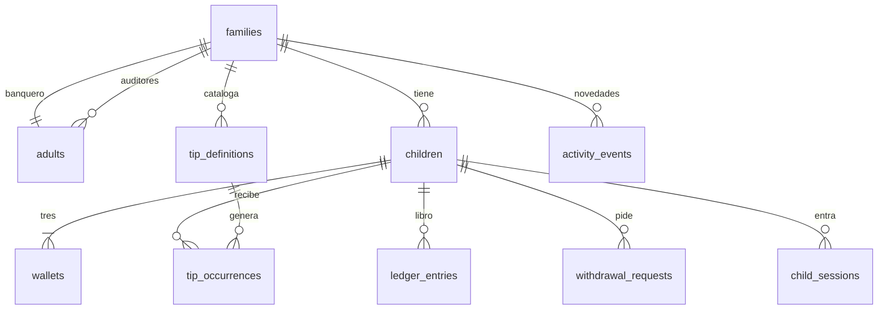

# DataBase

Modelo de MiUcha. Motor: MongoDB Atlas. Conexión: `MONGODB_URI`. Base: `MONGODB_DB_NAME`. Cliente en `src/lib/mongodb.ts`.

El libro de movimientos es la fuente auditable. El saldo de cada Ucha es la proyección, y se actualiza en la misma transacción que el asiento. Los montos son pesos enteros (`amountMinor`, `balanceMinor`).

## Diagrama

## families

La crea el superusuario, junto con su banquero. El nombre lo pone el banquero; queda vacío hasta entonces.

| Campo | Significado |
| --- | --- |
| `name` | Nombre que le pone el banquero |
| `banqueroId` | Adulto que guarda la plata |
| `pctInversion` | Porcentaje de Inversión. Con los otros dos suma 100 |
| `pctGasto` | Porcentaje de Gasto |
| `pctDonaciones` | Porcentaje de Donaciones |
| `interestPercent` | Tasa mensual de la inversión. `10` es 10 %. Cero no abona |
| `timezone` | `America/Santiago` |
| `currency` | `CLP` |
| `createdAt` | Alta |

## adults

Banquero y auditores. Entran por Clerk.

| Campo | Significado |
| --- | --- |
| `familyId` | Familia |
| `role` | `banquero` o `auditor` |
| `name` | Nombre |
| `email` | Correo, en minúsculas |
| `clerkUserId` | Identidad en Clerk |
| `active` | Si puede entrar |
| `createdAt` | Alta |

Índice único de `email` dentro de la familia. Índice de `clerkUserId`.

Hay un banquero activo por familia.

## children

| Campo | Significado |
| --- | --- |
| `familyId` | Familia |
| `name` | Nombre que ve la familia |
| `birthDate` | Fecha de nacimiento |
| `loginId` | Identificador para entrar. Único en toda la aplicación, para no revelar la familia |
| `pinHash` | PIN de 6 dígitos, con hash lento y sal. No sale del servidor |
| `pinAttempts` | Intentos fallidos |
| `pinLockedUntil` | Hasta cuándo no se acepta otro intento |
| `active` | Si puede entrar. Desactivarlo no borra el libro |
| `createdAt` | Alta |

Al crear un niño se crean sus tres Uchas en cero.

## wallets

Tres por niño. Los tipos son fijos: `inversion`, `gasto`, `donaciones`.

| Campo | Significado |
| --- | --- |
| `familyId` | Familia |
| `childId` | Niño |
| `type` | Cuál de las tres |
| `balanceMinor` | Saldo en pesos. No baja de cero |
| `updatedAt` | Último movimiento |

Índice único: `familyId` + `childId` + `type`.

## tip_definitions

La lista parte con tareas de la casa. El banquero marca cuáles usan, les pone el precio, puede cambiar el nombre, eliminar una y agregar otra. Otra familia no la ve.

| Campo | Significado |
| --- | --- |
| `familyId` | Familia |
| `catalogKey` | Tarea fija, por ejemplo `hacer-la-cama` |
| `title` | Nombre de la tarea |
| `amountMinor` | Valor en pesos, mayor que cero |
| `frequency` | `once`, `daily` o `weekly` |
| `daysOfWeek` | Días, cuando es semanal |
| `assignedChildIds` | Niños a los que aplica |
| `active` | Si sigue generando ocurrencias |
| `startsOn` | Fecha de inicio, opcional |

## tip_occurrences

Una tarea concreta de un niño en una fecha.

| Campo | Significado |
| --- | --- |
| `familyId` | Familia |
| `childId` | Niño |
| `definitionId` | Tip del catálogo |
| `occurrenceDate` | Día, en hora de Santiago |
| `amountMinor` | Valor congelado al crear la ocurrencia |
| `status` | `available`, `submitted`, `needs_improvement` o `approved` |
| `submittedAt` | Cuándo marcó «¡Listo!» |
| `reviewedAt` | Cuándo la revisaron |
| `reviewerId` | Banquero o auditor que decidió |
| `reviewNote` | Qué puede mejorar, si volvió atrás |

Índice único: `familyId` + `childId` + `definitionId` + `occurrenceDate`.

Una ocurrencia `approved` no se reabre. El valor del catálogo puede cambiar después: esta fila conserva el suyo.

## ledger_entries

Asiento que no se edita ni se borra.

| Campo | Significado |
| --- | --- |
| `familyId` | Familia |
| `childId` | Niño |
| `walletType` | Ucha |
| `amountMinor` | Pesos con signo. Entra positivo, sale negativo |
| `kind` | `tip`, `transfer`, `withdrawal`, `interest`, `reversal` |
| `operationId` | Clave de idempotencia |
| `actorId` | Quién provocó el movimiento |
| `createdAt` | Momento |

Índice único: `operationId` + `walletType`.

Las claves estables son:

| Operación | `operationId` |
| --- | --- |
| Aprobar un Tip | `tipApproval:<occurrenceId>` |
| Interés del mes | `interest:<familyId>:<childId>:<YYYY-MM>` |
| Entregar un retiro | `withdrawal:<requestId>` |
| Transferencia | `transfer:<id nuevo>` |
| Reversa | `reversal:<id nuevo>` |

Aprobar un Tip escribe tres asientos, uno por Ucha, con el mismo `operationId` y distinto `walletType`. El interés escribe uno, en `inversion`.

Lo ahorrado en el mes, para esa tasa, es la suma de asientos de `inversion` de ese mes cuyos `kind` son `tip` o `transfer`, más los `withdrawal` negativos. Si el neto no es positivo, no hay asiento de interés.

## withdrawal_requests

Pedido de plata. El saldo no baja hasta `completed`.

| Campo | Significado |
| --- | --- |
| `familyId` | Familia |
| `childId` | Niño |
| `walletType` | Desde qué Ucha |
| `amountMinor` | Pesos pedidos |
| `note` | Para qué, opcional. En Donaciones puede decir a quién ayudó |
| `status` | `pending`, `completed` o `cancelled` |
| `createdAt` | Pedido |
| `completedAt` | Entrega |
| `banqueroId` | Quién marcó la entrega |

Los `pending` del niño y la Ucha cuentan contra el saldo disponible.

## child_sessions

| Campo | Significado |
| --- | --- |
| `familyId` | Familia |
| `childId` | Niño |
| `tokenHash` | La cookie guarda el token. La base guarda el hash |
| `expiresAt` | Vencimiento |
| `revokedAt` | Cierre de sesión, si salió antes |

## activity_events

Novedades. Marcar como leído no resuelve la tarea.

| Campo | Significado |
| --- | --- |
| `familyId` | Familia |
| `eventType` | Qué pasó o qué hay que hacer |
| `entityId` | Ocurrencia, retiro u otro documento |
| `recipientIds` | Quién la ve |
| `createdAt` | Momento |
| `readBy` | Quién ya la vio |

Un Tip por revisar y un retiro pendiente siguen en «Por hacer» hasta que cambie su estado de negocio.

## job_runs

Control del cron. No lo ve la familia.

| Campo | Significado |
| --- | --- |
| `jobName` | `occurrences` o `interest` |
| `periodKey` | El día, o `YYYY-MM` para el interés |
| `status` | `ok` o `failed` |
| `counts` | Cuántas filas creó |
| `errors` | Texto del fallo, sin PIN ni secretos |
| `startedAt` | Inicio |
| `completedAt` | Fin |

Índice único: `jobName` + `periodKey` cuando el trabajo ya quedó `ok`, para no repetir el interés del mismo mes.
